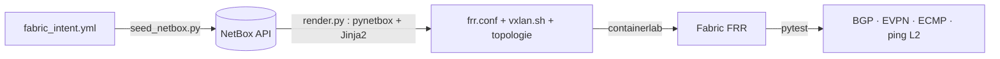

# Fabric datacenter EVPN-VXLAN pilotée par NetBox

Fabric **spine-leaf EVPN-VXLAN** entièrement générée depuis **NetBox**, utilisé comme **source de vérité** : équipements, interfaces, adresses IP, câbles et ASN sont dans NetBox, et un script Python en déduit la topologie containerlab et les configurations FRRouting. Une **CI GitHub Actions** démarre NetBox, génère, déploie et teste la fabric à chaque push.

## Architecture

```
            spine1 (AS 65000)        spine2 (AS 65000)
              |        \              /        |
              |         \____  ______/         |      underlay eBGP /31 + ECMP
              |          ____\/______          |      overlay  BGP EVPN (l2vpn evpn)
              |         /            \         |
         leaf1 (AS 65011) ==VXLAN VNI 100== leaf2 (AS 65012)
              |                                |
         host1 10.10.100.11/24          host2 10.10.100.12/24   (même LAN L2 étendu)
```

## Chaîne d'automatisation



- **NetBox** : sites, rôles, équipements, interfaces, IP, câbles ; ASN et VNI dans le *config context*.
- **render.py** : déduit les voisins BGP **à partir des câbles NetBox** (pas de liste codée en dur), génère `frr.conf`, le script VXLAN des leafs et le fichier containerlab.
- **Tests de recette Robot Framework** (`tests/robot`) : les mêmes vérifications écrites en scénarios lisibles, avec une bibliothèque Python de mots-clés ; le rapport HTML est publié en artefact de la CI.
- **Tests pytest** : sessions BGP IPv4 et EVPN établies sur les 4 switches, VNI 100 avec VTEP distant, ECMP vers les loopbacks via les 2 spines, ping L2 host1 → host2 à travers le tunnel VXLAN.

## Stack

NetBox 4 (Docker Compose), Python (pynetbox, Jinja2, pytest), Robot Framework, FRRouting 9 (BGP EVPN), Linux VXLAN/bridge, containerlab, GitHub Actions.

## Lancer en local

```bash
make netbox && make seed   # NetBox sur http://localhost:8000 (admin / admin)
make deploy                # génération depuis NetBox + déploiement
make test
make destroy
```

## Pistes d'évolution

Routage symétrique IRB (L3VNI) et multi-tenant (VRF), validation de la configuration avec Batfish, déploiement par Nornir, synchronisation de l'état réel vers NetBox.
